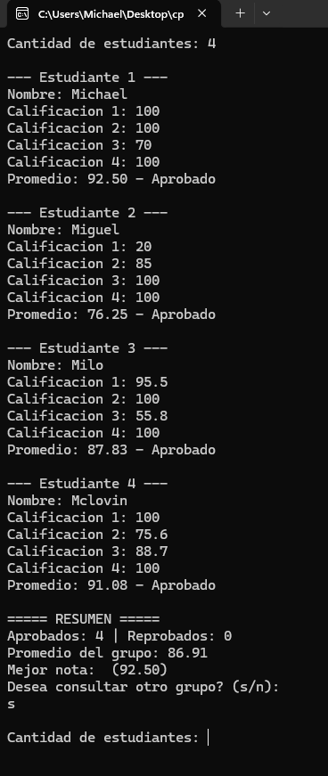
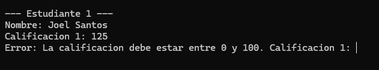

# Sistema de Registro de Calificaciones - Centro Educativo "La Nueva Escuela"

* **Estudiante:** Michael J. Paniagua
* **Matrícula:** 2025-3196

## Descripción del Programa
Aplicación desarrollada para automatizar el registro y cálculo de calificaciones de los estudiantes del centro educativo "La Nueva Escuela", evitando errores manuales. Permite ingresar grupos de estudiantes, validar notas, calcular promedios individuales y generar un resumen estadístico del grupo.

## Datos de Entrada, Proceso y Salida

* **Datos de Entrada:**
  * Cantidad de estudiantes del grupo (entero mayor que 0).
  * Nombre completo de cada estudiante.
  * 4 calificaciones por estudiante (valores numéricos entre 0 y 100).
  * Confirmación (`s` o `n`) para procesar un nuevo grupo.

* **Proceso:**
  * Validación de rangos numéricos para evitar datos erróneos.
  * Acumulación de las 4 notas por estudiante y cálculo de su promedio aritmético.
  * Clasificación del estado académico (Aprobado si el promedio es mayor o igual a 70; Reprobado si es menor).
  * Conteo total de aprobados y reprobados, cálculo del promedio general del grupo e identificación del promedio más alto.

* **Salida:**
  * Promedio individual con dos decimales y estado (Aprobado / Reprobado) por cada estudiante.
  * Resumen final del grupo con el total de aprobados, total de reprobados, promedio general del grupo y el nombre junto al promedio del estudiante más destacado.

## Uso de las Estructuras Repetitivas (Bucles)

1. **Bucle `do-while` (Repetición del programa):** Se utilizó para envolver la lógica principal y preguntar al final si se desea procesar otro grupo (`s/n`). Esto garantiza que el programa se ejecute al menos una vez antes de evaluar la condición de salida.
2. **Bucle `while` (Validación de datos):** Se empleó tanto para validar que la cantidad de estudiantes sea mayor que 0 como para verificar que cada calificación esté entre 0 y 100. Se eligió `while` porque no se sabe cuántas veces el usuario podría digitar un dato incorrecto.
3. **Bucle `for` (Recorrido de estudiantes y calificaciones):** Se utilizó un `for` externo para iterar desde el estudiante 1 hasta `cantidadEstudiantes`, y un `for` interno para solicitar exactamente las 4 notas de cada alumno. Es la estructura adecuada porque en ambos casos conocemos la cantidad exacta de repeticiones.

## Capturas de Pantalla de Ejecución

* **Datos de Entrada:**
  * Compilacion exitosa del programa.

  * Error cuando se coloca un numero mayor que 100.
